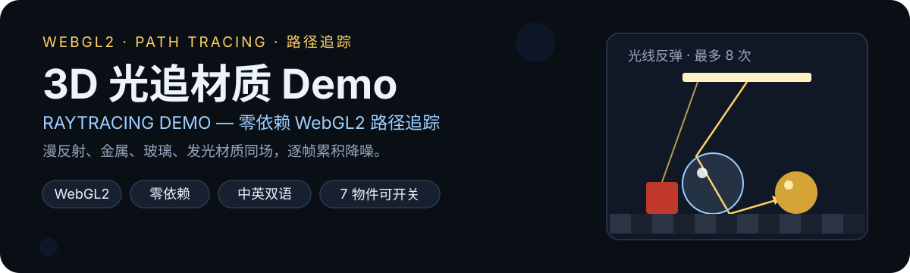
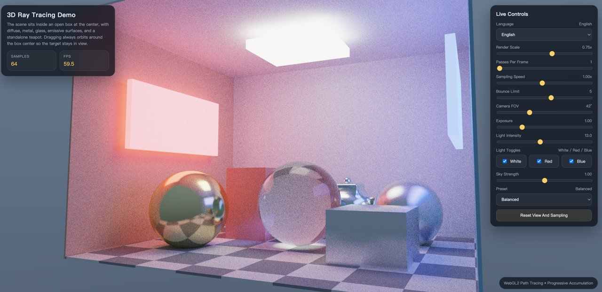

<p align="right"><a href="README.md">中文</a></p>

<p align="center">
  
</p>

<p align="center">
  <a href="https://xiaosang.cc/raytracing-demo/">▶ Live Demo</a>
  ·
  <a href="https://holynova.github.io/raytracing-demo/">GitHub Pages Mirror</a>
  ·
  <a href="https://github.com/holynova/raytracing-demo">GitHub Repository</a>
</p>

Raytracing Demo: a zero-dependency WebGL2 path tracing example that renders an open-box scene live in the browser — diffuse walls, a checkerboard floor, a red box, a brushed-metal pedestal, metal and gold spheres, a glass sphere, and a floating diamond at the center, lit by white / red / blue emissive panels. Samples accumulate frame by frame, so noise fades away while the camera stays still.

## Screenshot

<p align="center">
  
</p>

> The screenshot is a proportionally scaled-down version of the repo's `demo.png` (3800×1846 → 1280×622). The HUD text in it comes from an older version (it mentions a teapot); the scene's center is now a floating diamond, and the control panel matches the current version.

## Scene

- **Materials**: diffuse (walls, red box), metal (metal sphere, brushed-metal pedestal), gold (gold sphere), glass (glass sphere, with IOR refraction), emissive (white / red / blue light panels), diamond (floating at the center).
- **Floor**: black-and-white checkerboard.
- **7 objects, each switchable**: room, diamond, red box, metal pedestal, glass sphere, gold sphere, metal sphere.
- **3 lights, each switchable**: white, red, blue.

## Interaction & Controls

- **Drag**: orbit the camera; **scroll**: zoom. Moving the camera resets sampling and accumulation restarts.
- **Live control panel**: render scale (0.4–1×, default 0.75×), passes per frame (1–4), sampling speed (0.1–2×), bounce limit (1–8, default 5), camera FOV (28–70°, default 42°), exposure (0.6–2.2), light intensity (4–24, default 13), sky strength (0–2), three quality presets (Fast / Balanced / Quality), reset view and sampling.
- **HUD**: shows accumulated sample count and FPS in real time.
- **Bilingual UI**: switch the interface between English and 中文.

## Run Locally

Zero build, zero dependencies — just serve it statically (opening the file directly fails on ES-module CORS, which blocks `main.js`):

```bash
python3 -m http.server 8080
# Open http://localhost:8080
```

Requires a modern browser with WebGL2 and float render targets (`EXT_color_buffer_float`); otherwise a notice panel is shown.

## Tech

- The whole path tracer lives in a GLSL fragment shader (`main.js`, ~1200 lines), accumulating frame by frame into an RGBA32F float framebuffer, with sample count and frame rate shown live.
- Render scale and passes per frame are adjustable to trade quality against frame rate; any change to camera, FOV, exposure, or other parameters resets accumulation.

```
index.html          Entry: canvas + HUD + control panel + unsupported notice
main.js             All logic: WebGL2 context, GLSL path tracing, scene, camera, UI
demo.png            Rendered image shipped in the repo (3800×1846)
```
