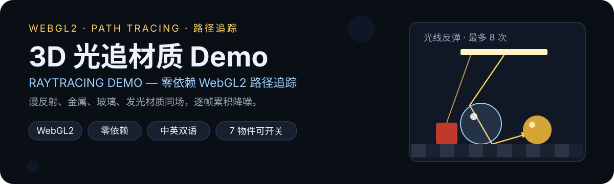
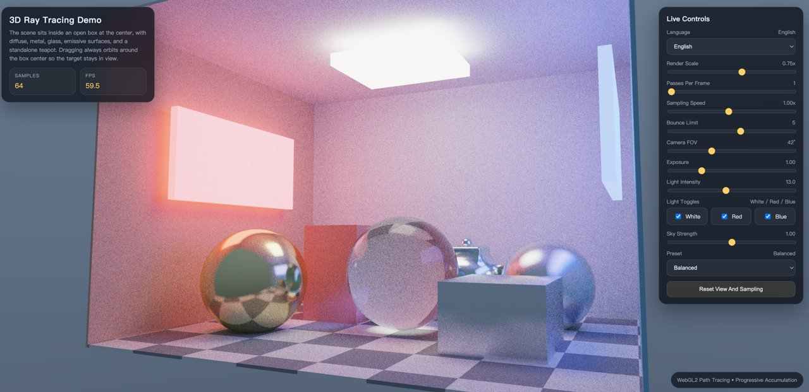

<p align="right"><a href="README.en.md">English</a></p>

<p align="center">
  
</p>

<p align="center">
  <a href="https://xiaosang.cc/raytracing-demo/">▶ 在线体验</a>
  ·
  <a href="https://holynova.github.io/raytracing-demo/">GitHub Pages 镜像</a>
  ·
  <a href="https://github.com/holynova/raytracing-demo">GitHub 仓库</a>
</p>

3D 光追材质 Demo：一个零依赖的 WebGL2 路径追踪示例，直接在浏览器里实时渲染一个开放式盒子场景——漫反射墙面、棋盘地面、红色方块、拉丝金属台体、金属球、金球、玻璃球与中央悬浮钻石，外加白 / 红 / 蓝三色发光灯板。画面逐帧累积采样，静止不动时噪点逐渐消失。

## 截图

<p align="center">
  
</p>

> 截图为仓库自带 `demo.png` 的等比缩小版（3800×1846 → 1280×622）。图中 HUD 文案来自旧版本（写的是茶壶），当前场景中央已改为悬浮钻石，控制面板与当前版本一致。

## 场景

- **材质**：漫反射（墙面、红方块）、金属（金属球、拉丝金属台体）、金（金球）、玻璃（玻璃球，折射率 IOR）、发光（白 / 红 / 蓝灯板）、钻石（中央悬浮）。
- **地面**：黑白棋盘格。
- **7 个物件可独立开关**：房间、钻石、红方块、金属台体、玻璃球、金球、金属球。
- **3 盏灯可独立开关**：白灯、红灯、蓝灯。

## 交互与控制

- **鼠标拖动**：环绕旋转视角；**鼠标滚轮**：缩放镜头。相机变化后自动重置采样并重新累积。
- **实时控制面板**：渲染比例（0.4–1×，默认 0.75×）、每帧采样次数（1–4）、采样速度（0.1–2×）、反弹上限（1–8 次，默认 5）、相机 FOV（28–70°，默认 42°）、曝光（0.6–2.2）、灯光强度（4–24，默认 13）、天空强度（0–2）、三档质量预设（Fast / Balanced / Quality）、重置视角与采样。
- **HUD**：实时显示累积采样数与 FPS。
- **中英双语**：界面语言可在 English / 中文之间切换。

## 本地运行

零构建、零依赖，起一个静态服务器即可（直接双击打开会因 ES 模块 CORS 限制无法加载 `main.js`）：

```bash
python3 -m http.server 8080
# 打开 http://localhost:8080
```

需要支持 WebGL2 与浮点渲染目标（`EXT_color_buffer_float`）的现代浏览器；不支持时会显示提示面板。

## 技术

- 路径追踪全部在 GLSL 片元着色器里完成（`main.js`，约 1200 行），逐帧累积进 RGBA32F 浮点帧缓冲，采样数与帧率实时回显。
- 渲染比例与每帧采样次数可调，在画质与帧率之间权衡；相机、FOV、曝光等任何参数变化都会重置累积。

```
index.html          入口：画布 + HUD + 控制面板 + 不支持提示
main.js             全部逻辑：WebGL2 上下文、GLSL 路径追踪、场景、相机、UI
demo.png            仓库自带渲染图（3800×1846）
```
